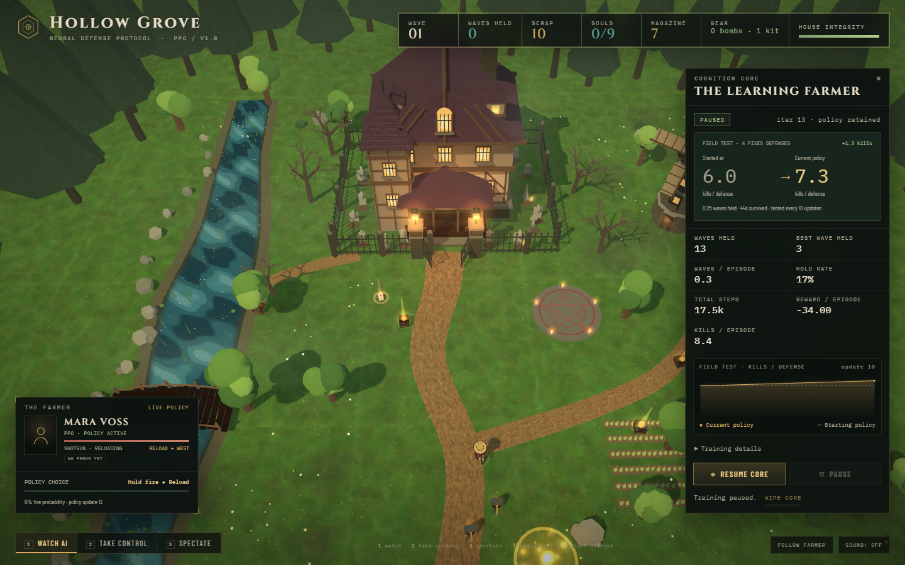
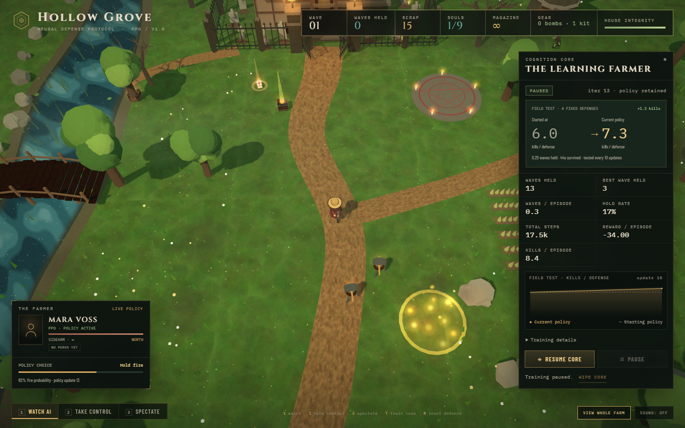
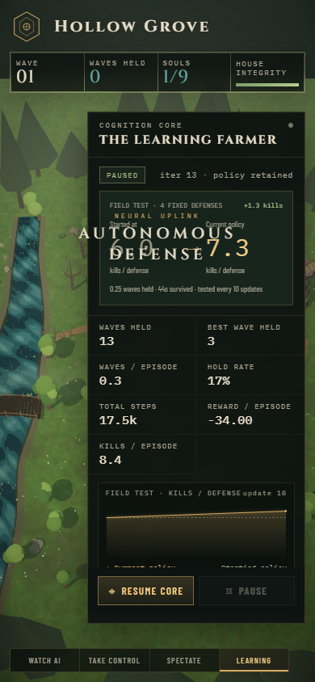
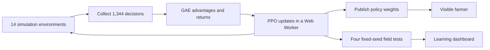

# HOLLOW-GRAVE

**Watch a farmer learn to defend Hollow Grove with Proximal Policy Optimization.**

[](https://github.com/abanerjee84/HOLLOW-GRAVE/actions/workflows/test.yml)
[](LICENSE)
[](https://nodejs.org/)

Hollow Grove is a top-down Three.js defense game with PPO written in JavaScript. A farmer protects the house against escalating zombie waves while a browser worker trains the policy across 14 environments. The visible farmer receives updated weights after each training update. Watch the decisions, follow the farmer, or take control while the worker keeps learning.

The game and its headless tests need no npm runtime packages, build step, Python installation, GPU compute framework, API key, or paid service. Three.js is bundled; the scenery, characters, textures and effects are generated in code.



## Contents

[Quick start](#quick-start) · [Screenshots](#screenshots) · [Controls](#controls) · [Learning](#how-learning-works) · [State and actions](#state-and-action-spaces) · [Reward](#reward-function) · [Results](#measured-learning) · [Checkpoints](#checkpoints) · [Tests](#tests-and-developer-tools) · [Structure](#project-structure) · [Troubleshooting](#troubleshooting) · [License](#license)

## Quick start

You need **Node.js 22.12 or newer** and a browser with WebGL and Web Worker support. The project was developed and checked locally with Node.js 24 and Chrome. CI runs headless checks on Node.js 22 and 24, on Windows and Linux.

### Windows

```powershell
git clone https://github.com/abanerjee84/HOLLOW-GRAVE.git
cd HOLLOW-GRAVE
.\START.bat
```

Or download the repository as a ZIP, extract it, and double-click **START.bat**. The launcher checks for Node.js, starts the server, and opens the game.

### From a terminal

```bash
git clone https://github.com/abanerjee84/HOLLOW-GRAVE.git
cd HOLLOW-GRAVE
npm start
```

Open the printed address, normally **http://localhost:8080**. The server listens on the local machine and tries the next 12 ports if the first one is occupied. Automatic browser opening is provided on Windows; on other platforms, open the URL yourself. Press **Ctrl+C** to stop the server.

**`npm install` is not needed to play or run `npm test`.** The npm dependency is an optional browser automation tool. Google Fonts requests fall back to system fonts when unavailable. Use HTTP instead of opening `index.html` through `file://`.

## Screenshots

These are actual application captures from a separate live browser session, rather than the fixed-seed benchmark below.

### Follow the farmer

The close camera makes movement, weapon changes, turret deployment and combat easier to follow. The farmer panel shows sampled actions and fire probability.



### Phone layout

On narrow screens, **Learning** toggles the dashboard so the farm stays visible when it is closed. The expanded panel scrolls and keeps training controls accessible.



## Controls

| Control | Effect |
|---|---|
| **Watch AI** / `1` | Current PPO policy controls the farmer |
| **Take Control** / `2` | Play manually; worker training continues independently |
| **Spectate** / `3` | Hide most HUD elements for a cinematic view |
| `Escape` | Return to Watch AI |
| **Follow Farmer** | Switch between overview and close-follow camera |
| **Train Core / Resume Core** / `T` | Start or resume optimization |
| **Pause** | Stop optimization; current policy keeps playing |
| `R` | Restart the visible defense without wiping the policy |
| **Wipe Core** | Confirm removal of the active saved policy and start fresh |
| **Sound** | Toggle audio, which starts disabled |

Manual play:

| Key or button | Action |
|---|---|
| `WASD` / arrow keys | Move |
| Mouse | Aim |
| Left mouse button / `F` | Fire |
| Right mouse button / `X` | Cycle owned weapons |
| `Z` | Reload |
| `E` | Build turret |
| `Q` | Throw firebomb |
| `V` | Use medkit |
| `Space` | Dash |

The farmer starts with a sidearm, shotgun, scrap, two firebombs and a medkit. The rifle must be found. Four collectible perks improve vitality, speed, weapon/reload timing and salvage. Clearing a wave starts a larger wave within the same episode. Death or house loss ends the defense. A 480-second safety cap truncates unbroken defenses and bootstraps their final value during training.

## How learning works



The shared simulation handles movement, enemies, combat, inventory, drops, turrets, fires and waves. Each training action advances through four 0.05-second ticks. The network has shared tanh layers of 128 and 96 units, four categorical policy heads, and a scalar value head. PPO and Adam are implemented directly in JavaScript.

| Training setting | Value |
|---|---:|
| Parallel environments | 14 |
| Rollout per environment | 96 decisions |
| Simulated time per decision | 0.2 seconds |
| Samples per update | 1,344 |
| Optimization epochs | 4 |
| Minibatch size | 256, with a final smaller batch |
| Discount `gamma` | 0.99 |
| GAE `lambda` | 0.95 |
| PPO clipping | 0.2 |
| Initial learning rate | 0.0005 |
| Maximum mean-gradient norm | 0.6 |
| Entropy coefficient | 0.014 decaying toward 0.004 |
| Browser field-test cadence | Every 10 updates |

The field agent samples actions, so it continues exploring. **Automatic aiming is an environment mechanic:** it selects a nearby living enemy within the equipped weapon's range and turns toward it. PPO learns movement, weapon selection, firing and utility use. Aiming and target selection are not policy heads.

The dashboard compares the starting policy with the current policy on four fixed evaluation seeds. These seeds are separate from rollout seeds. Evaluation uses its own seeded sampling stream and does not consume training randomness. The curve shows regressions as well as improvements. Reward alone is not treated as evidence of better defense.

## State and action spaces

**Observation: 422 values.** The policy receives its position, health, aim, inventory, weapon states and cooldowns; all 16 concurrent enemies; the house; all four turrets and four crates; all three pickups and their contents; active fires; routes; wave progress; and relevant timers. Additional fields distinguish distant enemies, higher-wave stats, larger scrap balances, off-weapon reloads, active dash, invulnerability and regeneration state.

**Action: `MultiDiscrete([9, 4, 2, 6])`.**

| Head | Choices |
|---|---|
| Movement | Stay plus eight compass directions |
| Weapon | Keep current, sidearm, shotgun, rifle |
| Fire | Hold fire or fire |
| Utility | None, turret, molotov, dash, medkit, reload |

There are **432 combinations before validity masks**. Movement, weapon selection, firing and one utility can occur together. Unavailable choices are masked using ownership, ammunition, stock, health, capacity and cooldowns. Fire/reload availability accounts for the selected weapon. PPO recomputes the same masks from stored observations when calculating joint log probabilities.

[RL_DESIGN.md](RL_DESIGN.md) contains the complete observation layout, control constraints, normalization, masks and verification details.

## Reward function

| Event | Reward |
|---|---:|
| Actual enemy health removed | `+0.05 × damage` |
| Walker / runner / brute kill | `+4.5 / +5.5 / +13` |
| Clear wave `w` | `9 × (1 + 0.12w) + 12 × house_fraction + 8 × health_fraction` |
| First weapon discovery | `+15` |
| First acquisition of a perk | `+20` |
| Farmer damage | `−0.4 × damage` |
| House damage | `−0.7 × damage` |
| Farmer death / house loss | `−22 / −26` |
| Simulated time | `−0.01 per second` |

Overkill does not inflate damage reward. Switching weapons, deploying a turret, throwing a bomb and using a medkit receive no standalone bonuses. Repeatable resources use bounded potential shaping:

```text
Phi(s) = 0.5 × scrap / 999
       + 0.01 × finite ammo in owned weapons
       + 0.15 × (medkits + bombs)

reward = task_reward + gamma × Phi(next_state) − Phi(current_state)
```

This accounts for gaining and spending resources. Reloading preserves total ammo. A shoot–reload–refill cycle cannot earn a positive shaping return. True terminal states use zero final potential; time-limit truncations retain it. See the implementation and [source paper](https://people.eecs.berkeley.edu/~russell/papers/icml99-shaping.pdf) in [the reward notes](RL_DESIGN.md#reward).

## Measured learning

[learning_report.json](learning_report.json) records a deterministic 160-update experiment using seed **42** and **215,040 training decisions**. The headless probe evaluates every 20 updates on the same four evaluation seeds.

| Mean across four evaluation defenses | Starting policy | After 160 updates |
|---|---:|---:|
| Kills | 5.5 | 63 |
| Waves held | 0 | 4 |
| Survival | 43.3 seconds | 168.6 seconds |

This is a small benchmark, not a guarantee for every seed. Intermediate evaluations are not monotonic. The report includes per-seed results so the averages can be checked.

```bash
npm run train:probe
# Or choose update count and experiment seed:
node train_probe.mjs 160 42
```

The probe overwrites `learning_report.json`. It is a CPU workload whose elapsed time depends on the machine. It saves a report, not a pretrained model. The game learns from scratch on its first run in a browser.

## Checkpoints

Weights, evaluation history and cumulative counters save periodically in browser `localStorage`. Pausing and closing the page also request a save. Reload resumes from those weights; Adam moments and unfinished training episodes restart. This is policy persistence, not a bit-for-bit continuation of training.

Storage belongs to the browser origin, including its port: `localhost:8080` and `localhost:8081` have separate policies. Keep the same port to resume a run. The current schema uses `hollow-grove-ppo-v8`; earlier v7 checkpoints remain stored but cannot be loaded into the expanded network.

The game does not upload policies or training data. Clearing browser storage or confirming **Wipe Core** removes the active saved policy.

## Tests and developer tools

### Headless checks

```bash
npm test
```

The suite covers inventory and episodes, seven earlier logic regressions, and 13 state/action/reward checks. Cases include omitted-state distinctions, combined actions, masks, rifle-range aiming, reward farming, terminal versus truncated shaping, and numerical policy/shared-layer gradients. No browser or package installation is required.

### Optional browser checks and screenshots

Install the pinned development dependency and its browser:

```bash
npm ci
npx puppeteer browsers install chrome
```

With the app running in another terminal:

```bash
npm run test:ui
npm run screenshot
```

The default target is `http://localhost:8080/`. Use `URL` to select another address and `CHROME_PATH` to select an existing Chrome executable instead of Puppeteer's downloaded browser. The smoke check exercises training, pause/resume, checkpoints, manual control, cameras and desktop/mobile layouts.

PowerShell screenshot example:

```powershell
$env:URL = 'http://localhost:8080/'
$env:OUT = 'shot.png'
$env:WAIT = '16000'
npm run screenshot
```

The optional `ui_check.py` helper requires Playwright for Python and a separately installed Playwright browser. It is not used by the game or `npm test`.

`node diag_actions.mjs 60 4` compares greedy and sampled action frequencies after a short training run. The live game uses sampled actions.

## Project structure

```text
src/
  main.js                 Scene, input, HUD, weights and checkpoints
  style.css               Desktop and responsive interface
  sim/
    env.js                Simulation, observations, actions, masks and reward
    ppo.js                Shared MLP, actor heads, critic, PPO and Adam
    worker.js             Rollouts, GAE, training and metrics
    evaluate.js           Fixed-seed policy evaluation
  world/
    environment.js        Procedural farm, house, river, forest and lighting
    characters.js         Farmer and zombie geometry and animation
    effects.js            Combat effects, pickups, turrets and fires
    materials.js          Materials and procedural textures
docs/screenshots/         Actual application screenshots
vendor/                   Bundled Three.js and its license
index.html                App entry point and import map
server.mjs                Local static server
START.bat                 Windows launcher
sim_test.mjs              Simulation checks
logic_review_checks.mjs   Earlier logic regressions
rl_space_test.mjs         Observation, action, reward and gradient checks
train_probe.mjs           Reproducible learning experiment
RL_DESIGN.md              Detailed RL contract and reward rationale
LOGIC_REVIEW.md           Historical bug audit and resolution notes
```

## Troubleshooting

- **START.bat cannot find Node.js:** install Node.js, reopen the terminal, and check `node --version` before retrying.
- **Blank page or module/worker errors:** use HTTP instead of `file://`, check the browser console, and use a WebGL-capable browser.
- **A changed port looks like a new policy:** browser storage is separate per port. Return to the original port or start a new run deliberately.
- **The farmer initially performs poorly:** a first run uses random weights. Leave training active and compare multiple field tests.
- **The latest field test regressed:** inspect several evaluations instead of one update or the reward total.
- **Low frame rate:** try a smaller window, close graphics-heavy tabs, and check browser hardware acceleration. Training is CPU JavaScript; the scene uses WebGL rendering.
- **Screenshot tool cannot find Chrome:** run the browser-install command above, or set `CHROME_PATH` to a compatible installed browser.

## Contributing

Keep the renderer, worker and headless probe on the same simulation/action contract. When changing observations or action heads, update the schema, masks, tests and checkpoint version together. Run `npm test` and describe learning changes with a reproducible experiment and its seed.

## License

Project code and documentation are available under the [MIT License](LICENSE). Bundled Three.js retains its MIT copyright notice and [complete license](vendor/THREE-LICENSE.txt). See [THIRD_PARTY_NOTICES.md](THIRD_PARTY_NOTICES.md) for attribution and font details.
